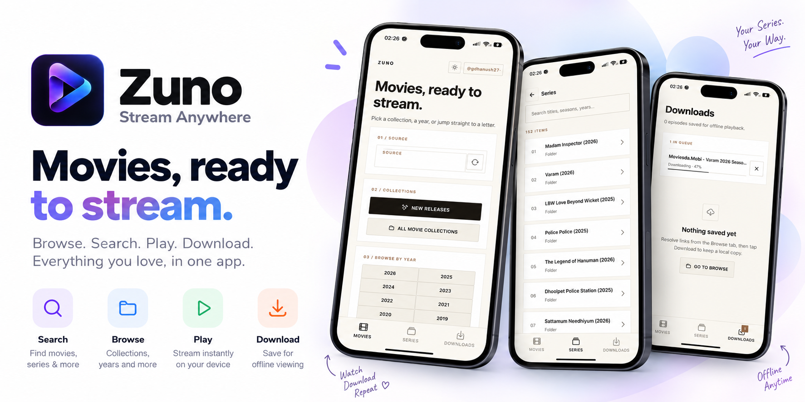
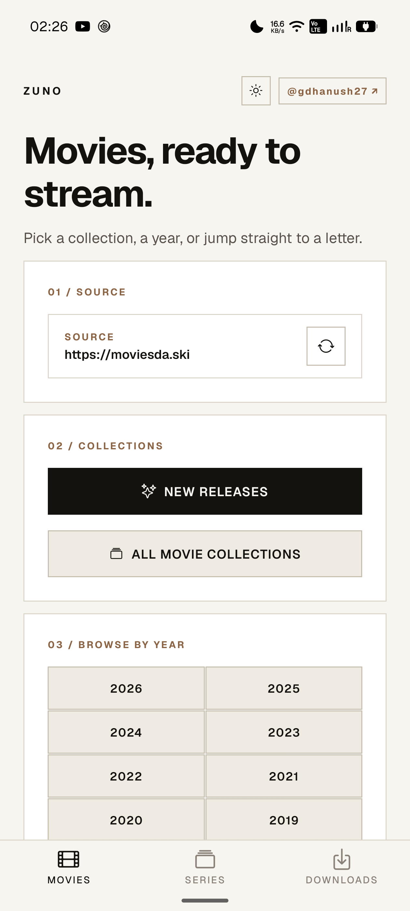
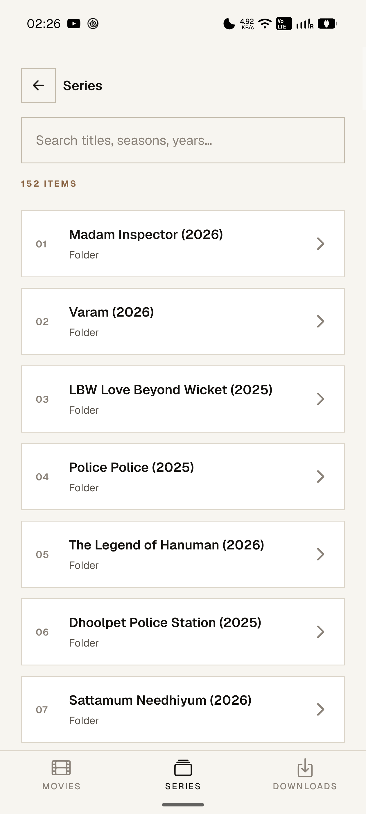
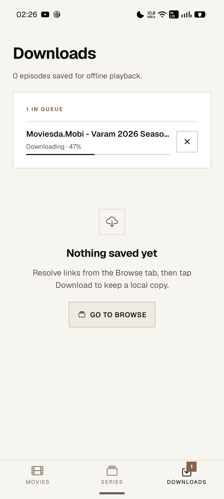

# Zuno — Stream Anywhere

<p align="center">
  
</p>

Your series and movies, your phone, your rules. Zuno finds episodes and films, lines them up, and keeps your favourites ready to watch even when the signal drops.

No accounts. No clutter. Just search, tap, and press play.

> **v0.1 — first stable release, out of beta.** Ships a refreshed identity, Expo SDK 58 / React Native 0.88, and full movie support alongside series.

## Why you'll like it

- **Movies and series in one place** — browse both catalogs side by side from dedicated tabs.
- **Find it fast** — search across catalogs, series, seasons, and movies with smart A-Z sorting.
- **Binge without breaks** — next and previous controls roll straight into the following episode.
- **Watch offline** — saved episodes play from your device, no connection required.
- **Pick up where you left off** — Zuno remembers your spot in every episode.
- **Stays yours** — everything lives on your phone, and deleting a download really deletes it.

## Screenshots

<table>
  <tr>
    <td align="center" width="33%"></td>
    <td align="center" width="33%"></td>
    <td align="center" width="33%"></td>
  </tr>
  <tr>
    <td align="center">Movies</td>
    <td align="center">Series search</td>
    <td align="center">Downloads</td>
  </tr>
</table>

## How it works

1. Point Zuno at your source.
2. Pick **Movies** or **Series** and browse or search until something catches your eye.
3. Tap the episodes or the film you want.
4. Let Zuno fetch the links.
5. Press play, or save them for the road.

## Get started

```powershell
npm install
npm start
```

Run it on Android:

```powershell
npm run android
```

Run it on iOS (native build):

```powershell
npm run ios
```

Already have a development build installed?

```powershell
npm run start:dev
```

Runs on **Expo SDK 58** with React Native 0.88. The URL scheme is `zuno`, so deep links look like `zuno://...`.

## Good to know

- Zuno is built for Android and iOS. The web version is along for the ride, not the show.
- Keep the app open while links are loading or downloads are running.
- Streaming links can expire. If one goes stale, Zuno simply fetches a fresh one.
- Browsing history and search results reset when you close the app. Downloads stay put.
- Please use Zuno only with content you have the right to access.

## Release notes — v0.1

First stable release after beta.

- **New identity** — renamed to Zuno with a fresh icon, adaptive icon, favicon, and splash screen.
- **Full movie support** — movies tab, results screen, dedicated player, persisted movie store, and a movie API client.
- **Reworked home screen** and tab layout; refreshed downloads, series results, and player flows.
- **Theme system** — new theme store and expanded design system, documented in [design.md](./design.md).
- **Upgraded stack** — Expo SDK 58, React Native 0.88, React 19.3, and matching gesture-handler/reanimated/worklets majors.
- **Tests** — added coverage for the movie API client.

## Before you ship

```powershell
npm test
npm run typecheck
npm run lint
```

The suite covers the logic. Playback, downloads, and sharing deserve a real device and a comfortable chair.

## License

Zuno is released under the [GNU General Public License v3.0](LICENSE) or later.
